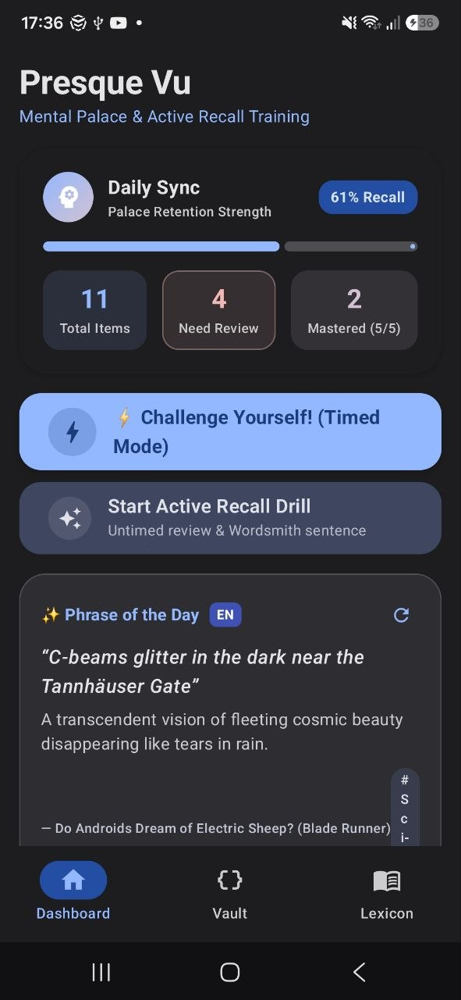
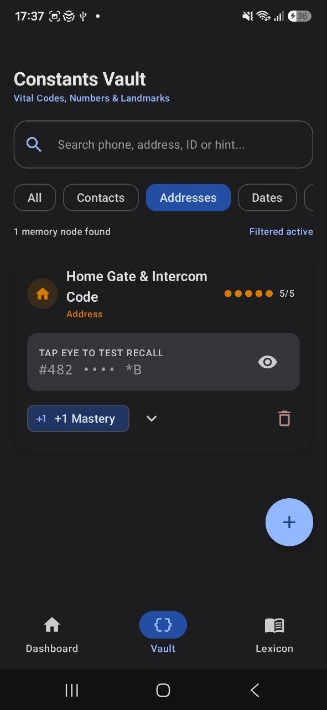
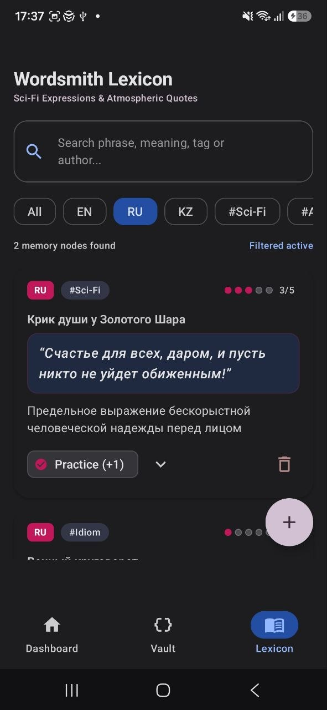
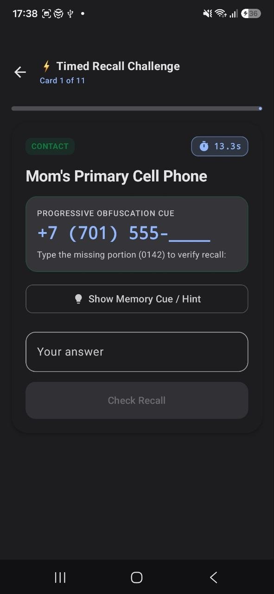
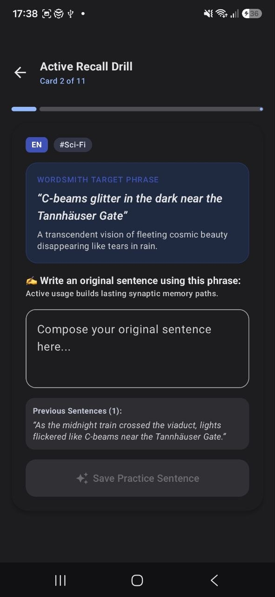

# Presque Vu (Tip-of-the-Tongue Memory Palace)

**Presque Vu** (French for *"almost seen"*, describing the universal *tip-of-the-tongue* phenomenon) is an Android application built in **Kotlin** using **Jetpack Compose** and **Material 3**.

The application functions as a personal mental palace designed to store, retrieve, and actively practice two critical classes of memory nodes:
1. **Vital Constants:** High-stakes personal facts we ought to know by heart without relying on internet access or physical cards: emergency contacts, building intercom codes, anniversary dates, and national identity numbers (IIN).
2. **Wordsmith Lexicon:** Expressive literary phrases, vivid descriptions, and sci-fi idioms across English (EN), Russian (RU), and Kazakh (KZ) to conquer writer's block and build active writing vocabulary.

---

## 📌 Quick Navigation for Evaluators

This repository encompasses both project milestones. Evaluators may review each phase directly:

- **[👉 Jump to Phase 2: Midterm Project Architecture & Features](#-phase-2-midterm-project-upgrade)** (Multi-screen Navigation, 15s Coroutines Timed Recall, Progressive Obfuscation, Wordsmith Sentence Practice, Reactive StateFlow)
- **[👉 Jump to Phase 1: Foundation & Core Concepts](#-phase-1-foundation-assignment)** (Original single-screen prototype, Data Model, Ephemeral vs. Persistent State Separation, Spoilers & Add Dialog)
- **[👉 Jump to Running Instructions & Tests](#-running-instructions--verification)**

---

## 🚀 Phase 2: Midterm Project Upgrade

The midterm project upgrades Presque Vu into a multi-screen, production-grade architecture using **Jetpack Compose Navigation**, **Kotlin Coroutines**, and **Reactive StateFlow** (`collectAsStateWithLifecycle`).

### 1. Navigation Architecture (4 Functional Screens)
Built with a `Scaffold` combining a Material 3 `NavigationBar` (Bottom Bar) and a `NavHost`:

| Screen | Route | Purpose & Key Components |
| :--- | :--- | :--- |
| **`DashboardScreen`** | `"dashboard"` | **Home hub:** Displays the "Daily Sync" retention summary card (total items, review needed, mastery percentage), the "Phrase of the Day" spotlight card with shuffle toggle, quick-jump cards, and two prominent drill CTA buttons. |
| **`ConstantsVaultScreen`** | `"constants_vault"` | **Presque Vu Tab:** The categorized vault of phone numbers, addresses, dates, and IDs with live search, category filter chips (`Contacts`, `Addresses`, `Dates`, `IDs`), masked spoiler cards with peek toggles, and FAB. |
| **`LexiconScreen`** | `"lexicon"` | **Wordsmith Tab:** Multilingual quote & sci-fi expression bank with language/vibe filter chips (`#Sci-Fi`, `#Atmosphere`, `EN`, `RU`, `KZ`), source book citations, sentence practice history display, and FAB. |
| **`ChallengeScreen`** | `"challenge/{isTimedMode}"` | **Recall & Practice Arena:** Accessible from Dashboard with `isTimedMode: Boolean` passed via navigation arguments. Hosts timed 15s challenges and untimed active recall drills. |

```
Screen Flow:
┌─────────────────┐       [Start Drill (Untimed)]       ┌────────────────────────────────┐
│ DashboardScreen │ ───────────────────────────────────> │ ChallengeScreen                │
│ (Daily Sync +   │                                      │ - Progressive Obfuscation      │
│  Spotlight)     │ ───> [⚡ Challenge! (Timed Mode)] ──> │ - Wordsmith Sentence Practice  │
└────────┬────────┘                                      │ - 15s Coroutine Countdown      │
         │ (Bottom Nav)                                  └────────────────────────────────┘
         ├──────────────────────────────┐
         ▼                              ▼
┌───────────────────────┐    ┌─────────────────────────┐
│ ConstantsVaultScreen  │    │ LexiconScreen           │
│ (Vital Numbers/Codes) │    │ (Literary Quotes/Idioms)│
└───────────────────────┘    └─────────────────────────┘
```

---

### 2. Core New Midterm Features

#### ⚡ Feature 1: "Challenge Yourself!" Timed Recall (Coroutines)
- **Coroutine Timer:** Implemented in `ChallengeScreen.kt` using `LaunchedEffect(cardId, isSubmitted)` and `delay(100L)` to count down from 15.0 seconds per card.
- **Dynamic Visual Feedback:** The timer badge shifts colors smoothly from Primary/Green (`> 8s`) $\rightarrow$ Amber (`4s–8s`) $\rightarrow$ Error/Red (`< 4s`).
- **Progressive Obfuscation for Constants:**
  - Automatically splits sensitive values into a visible cue and masked characters (e.g. `+7 (701) 555 - ____` or `02111450____`).
  - Requires the user to type the missing digits/characters into an `OutlinedTextField` before time runs out.
  - Automatically grades the user's input, increments `masteryLevel` in the ViewModel on success (+1, max 5), reveals the full secret upon timeout/mistake, and advances to the next card.

#### ✍️ Feature 2: Wordsmith Sentence Practice
- When a `LexiconItem` appears during an active drill, the user is prompted:
  > *"Write an original sentence using this phrase:"*
- The user writes an original sentence applying the phrase in context.
- **Persistent Practice History:** The submitted sentence is saved into `practiceHistory: List<String>` inside the `LexiconItem` state in the `ViewModel`.
- Past practice sentences are reviewable in both the drill feedback card and when expanding `LexiconItemCard` in the Lexicon tab.

#### 🔄 Feature 3: Reactive StateFlow Architecture
- **Unidirectional Data Flow (UDF):** `PresqueVuViewModel` exposes a single, immutable `uiState: StateFlow<PresqueVuUiState>` using `MutableStateFlow` and `.asStateFlow()`.
- **Lifecycle-Aware State Collection:** All screens collect state in `PresqueVuApp.kt` using `collectAsStateWithLifecycle()`.
- **Strict State Hoisting:** Screens and child components accept plain state values and event lambdas (`onSearchQueryChange`, `onAddConstant`, `onAnswerConstant`, `onRecordLexiconSentence`) rather than holding direct references to the `ViewModel`.
- **Configuration Change Resilience:** Form drafts and quiz positions use `rememberSaveable`, while master items and filter states are held in the `ViewModel`—surviving device rotation seamlessly.

---

## 📸 Application Screenshots & Showcase

The repository contains device captures demonstrating both the Midterm features and core interface:

<p align="center">
  
  &nbsp;&nbsp;&nbsp;&nbsp;
  
  &nbsp;&nbsp;&nbsp;&nbsp;
  
</p>

<p align="center">
  
  &nbsp;&nbsp;&nbsp;&nbsp;
  
</p>

### Screenshot Reference Guide:
1. **`01_dashboard_screen.png` — Dashboard & Daily Sync:**
   - Shows the Daily Sync retention card with total nodes, items needing review, and mastery progress bar.
   - Highlights the random "Phrase of the Day" spotlight card with shuffle action.
   - Displays the two prominent action buttons (`[⚡ Challenge Yourself! (Timed Mode)]` and `[Start Active Recall Drill]`) and bottom `NavigationBar`.
2. **`02_constants_vault_screen.png` — Constants Vault:**
   - Categorized vault of phone numbers, addresses, dates, and IDs with search, Material 3 filter chips, and masked spoiler cards.
3. **`03_wordsmith_lexicon_screen.png` — Wordsmith Lexicon:**
   - Multilingual quote bank (`EN`, `RU`, `KZ`) with tag chips (`#Sci-Fi`, `#Atmosphere`), expandable source citations, and past practice sentences history.
4. **`04_challenge_timed_obfuscation.png` — 15s Timed Challenge & Progressive Obfuscation:**
   - Demonstrates the 15-second coroutine countdown badge and progressive obfuscation prompt (`+7 (701) 555 - ____`) requiring user digit entry.
5. **`05_challenge_sentence_practice.png` — Wordsmith Sentence Practice:**
   - Demonstrates the prompt to compose an original sentence with text entry, auto-grading, and mastery increment.

---

## 🏛️ Project Architecture & File Structure

```
com.example.engram/
├── MainActivity.kt                      # Edge-to-edge ComponentActivity launching PresqueVuApp
├── navigation/
│   └── PresqueVuDestinations.kt         # Screen sealed class, routes, and bottom navigation items
├── model/
│   └── MemoryNode.kt                   # MemoryNode interface, ConstantCategory enum,
│                                       # ConstantItem and LexiconItem data models (+ practiceHistory)
├── viewmodel/
│   ├── PresqueVuUiState.kt             # Immutable UI state (filtered lists, mastery metrics, spotlight)
│   └── PresqueVuViewModel.kt           # StateFlow management, coroutine evaluations, mutations
├── ui/
│   ├── PresqueVuApp.kt                 # Root navigation Scaffold, NavigationBar, NavHost, collectAsStateWithLifecycle
│   ├── PresqueVuScreen.kt              # Compatibility entrypoint delegating to PresqueVuApp
│   ├── screens/
│   │   ├── DashboardScreen.kt          # Screen 1: Daily Sync metrics, Spotlight card, Action CTAs
│   │   ├── ConstantsVaultScreen.kt     # Screen 2: Search, category chips, masked spoiler cards, FAB
│   │   ├── LexiconScreen.kt            # Screen 3: Multilingual quote bank, tags, practice history, FAB
│   │   └── ChallengeScreen.kt          # Screen 4: 15s Coroutine timer, Progressive Obfuscation, Sentence practice
│   ├── components/
│   │   ├── ConstantItemCard.kt         # Reusable card: spoiler mask, peek toggle, mastery dots, delete
│   │   ├── LexiconItemCard.kt          # Reusable card: typography quote box, attribution, practice history
│   │   ├── SearchHeader.kt             # Reusable search OutlinedTextField & scrollable FilterChip bar
│   │   ├── AddMemoryDialog.kt          # Modal dialog with Checkbox, PrimaryTabRow, inputs
│   │   ├── MasteryIndicator.kt         # 5 animated dots reflecting mastery level (0..5)
│   │   └── MemoryStatsBanner.kt        # Memory retention banner and progress indicator
│   └── theme/
│       ├── Color.kt                    # Twilight indigo, memory amber & semantic category accents
│       ├── Theme.kt                    # Material 3 dynamic and custom Dark/Light color schemes
│       └── Type.kt                     # Material 3 Typography scale
```

---

## 🧱 Phase 1: Foundation Assignment

*The original foundational milestone establishing the domain models, custom composables, and state lifecycle distinctions:*

### 1. Data Models
- **`MemoryNode` (Base Interface):**
  - Common properties: `id: String`, `title: String`, `dateAdded: Long`, `masteryLevel: Int` (0 to 5).
- **`ConstantItem` (Implements `MemoryNode`):**
  - Represents high-stakes vital facts: `secretValue: String`, `category: ConstantCategory` (`CONTACT`, `ADDRESS`, `DATE`, `ID_NUMBER`), `hint: String`.
- **`LexiconItem` (Implements `MemoryNode`):**
  - Represents literary phrases: `phrase: String`, `meaningOrContext: String`, `language: String` (`EN`, `RU`, `KZ`), `tag: String` (`#Sci-Fi`, `#Atmosphere`, `#Idiom`), `sourceBook: String`.

### 2. State Lifecycle Separation
The application distinguishes between ephemeral visual states, persistent UI configuration states, and business logic state:

| State Mechanism | Scope & Lifecycle | When Used in Presque Vu | Code Reference |
| :--- | :--- | :--- | :--- |
| **`remember`** | Lives only during composable lifespan. **Resets** on screen rotation (Activity recreation). | Ephemeral visual state that resets to test recall after device orientation changes (e.g. spoiler peek). | `ConstantItemCard.kt`:<br>`var isRevealed by remember { mutableStateOf(false) }` |
| **`rememberSaveable`** | Saved in `Bundle`. **Survives** screen rotation / configuration changes, but decoupled from ViewModel. | UI navigation states and modal draft inputs so user-typed text is **never lost** during rotation. | `ChallengeScreen.kt`:<br>`var currentIndex by rememberSaveable { mutableIntStateOf(0) }`<br><br>`AddMemoryDialog.kt`:<br>`var constantTitle by rememberSaveable { mutableStateOf("") }` |
| **`ViewModel`** | Bound to screen lifecycle via `ViewModelStore`. Survives Activity recreation. | Master repositories of memory nodes, computed retention strength, and persistent mutations. | `PresqueVuViewModel.kt`:<br>`val uiState: StateFlow<PresqueVuUiState>` |

---

## 🛠️ Running Instructions & Verification

### Requirements
- Android Studio Ladybug / Meerkat / Koala or newer
- JDK 17, 21, or 22
- Android SDK 35/37 (minSdk 24)

### Terminal Commands
```powershell
# Compile debug sources (checks all navigation routes, composables, and StateFlow)
.\gradlew compileDebugSources

# Run unit tests (verifies ViewModel mutations, recall grading, and practice history)
.\gradlew test

# Assemble debug APK
.\gradlew assembleDebug
```

### Running in Android Studio
1. Open the project root directory (`Engram`) in Android Studio.
2. Allow Gradle sync to complete.
3. Select an Android Emulator or physical device running Android 7.0 (API 24) or higher.
4. Click **Run 'app'** (`Shift + F10`).
