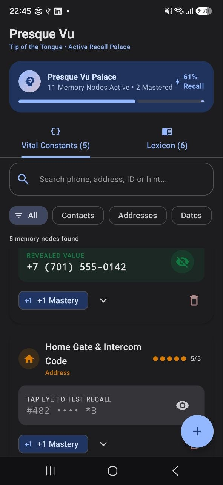
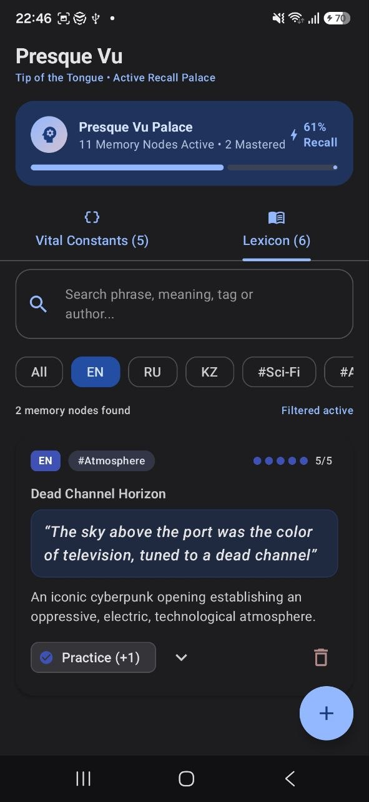
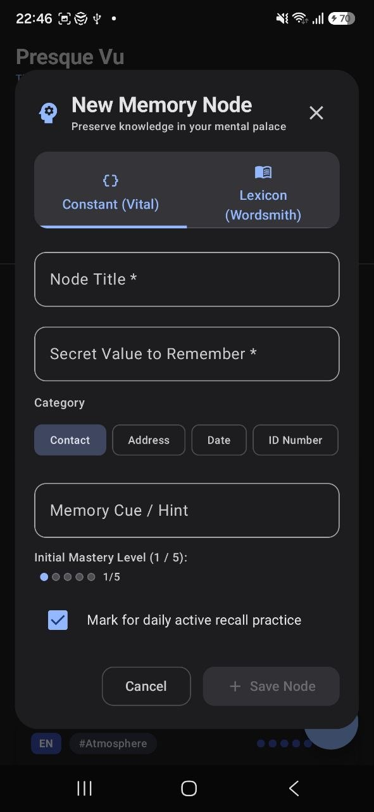

# Presque Vu (Tip-of-the-Tongue Memory Palace)

**Presque Vu** (French for *"almost seen"*, describing the universal *tip-of-the-tongue* phenomenon) is an Android application built in **Kotlin** using **Jetpack Compose** and **Material 3**.

The application functions as a personal memory palace designed to store, retrieve, and actively practice two critical classes of memory nodes:
1. **Vital Constants:** High-stakes personal info we ought to know by heart without relying on internet access or physical cards: emergency contacts, building intercom codes, anniversary dates, and national identity numbers (IIN).
2. **Wordsmith Lexicon:** Expressive literary phrases, vivid descriptions, and sci-fi idioms across English (EN), Russian (RU), and Kazakh (KZ) to conquer writer's block and build active writing vocabulary.

---

## Application Screenshots & Showcase

The repository includes real device captures demonstrating the user interface and core interactive features:

<p align="center">
  
  &nbsp;&nbsp;&nbsp;&nbsp;
  
  &nbsp;&nbsp;&nbsp;&nbsp;
  
</p>

### Screenshot Breakdown
1. **`screenshots/01_constants_tab.png` — Vital Constants & Active Recall:**
   - **Retention Strength Dashboard:** Displays total active memory nodes (11 active, 2 mastered) and overall recall percentage (61%).
   - **Interactive Spoiler Toggle:** Secret values are masked by default (`#482 •••• *B`) to test memory recall. Tapping the **Eye icon** reveals the secret in emerald green (`+7 (701) 555-0142`).
   - **Mastery Indicator Dots:** Visual 5-dot progression reflecting mastery levels (0 to 5) with quick `+1 Mastery` chip actions.
   - **Material 3 Filter Chips:** Quick category filtering by *Contacts*, *Addresses*, *Dates*, and *ID Numbers*.

2. **`screenshots/02_lexicon_tab.png` — Wordsmith Lexicon & Live Filtering:**
   - **Multilingual Support:** Displays language badges (`EN`, `RU`, `KZ`) and theme pills (`#Atmosphere`, `#Sci-Fi`, `#Idiom`).
   - **Literary Typography:** Expressive literary phrases styled with custom quotation blocks (e.g. William Gibson's *Neuromancer* opening).
   - **Live FilterChip Selection:** Shows active filtering with the `EN` chip selected, dynamically updating matching node count (*"2 memory nodes found — Filtered active"*).
   - **Practice Action:** Interactive `Practice (+1)` button to mark items reviewed and reinforce retention.

3. **`screenshots/03_add_memory_dialog.png` — Dynamic Node Creation Dialog:**
   - **Segmented Control:** Seamlessly switch between creating a *Constant (Vital)* node or a *Lexicon (Wordsmith)* node.
   - **Material 3 Inputs:** Includes `OutlinedTextField` with floating labels, category filter chips, and interactive initial mastery level selection.
   - **Checkbox Input:** Material 3 `Checkbox` to mark items for *"daily active recall practice"*.
   - **State Preservation (`rememberSaveable`):** All draft inputs survive device rotation and Activity recreation without data loss.

---

## Architectural & Data Model Design

The application follows clean architectural separation across `model`, `ui`, and `viewmodel`:

```
com.example.engram/
├── MainActivity.kt                      # Edge-to-edge ComponentActivity launching PresqueVuScreen
├── model/
│   └── MemoryNode.kt                   # Core MemoryNode interface, ConstantCategory enum,
│                                       # ConstantItem and LexiconItem data models
├── viewmodel/
│   └── PresqueVuViewModel.kt           # StateFlow master lists, search/filter algorithms,
│                                       # mastery progression, and node mutations
├── ui/
│   ├── PresqueVuScreen.kt              # TopAppBar, PrimaryTabRow, LazyColumns, empty state notices
│   ├── components/
│   │   ├── ConstantItemCard.kt         # Reusable card: Row, Column, Box, spoiler mask & peek
│   │   ├── LexiconItemCard.kt          # Reusable card: Row, Column, Box, quote styling & source
│   │   ├── SearchHeader.kt             # Reusable OutlinedTextField & scrollable FilterChip bar
│   │   ├── AddMemoryDialog.kt          # Modal dialog with Checkbox, segmented tabs, text fields
│   │   ├── MasteryIndicator.kt         # 5 animated dots reflecting mastery level 0..5
│   │   └── MemoryStatsBanner.kt        # Memory retention dashboard and progress indicator
│   └── theme/
│       ├── Color.kt                    # Twilight indigo, memory amber & semantic category accents
│       ├── Theme.kt                    # Material 3 dynamic and custom Dark/Light color schemes
│       └── Type.kt                     # Material 3 Typography scale
```

### Data Models
- **`MemoryNode` (Interface):**
  - `id: String`, `title: String`, `dateAdded: Long`, `masteryLevel: Int` (0 to 5).
- **`ConstantItem` (Implements `MemoryNode`):**
  - Adds `secretValue: String`, `category: ConstantCategory` (`CONTACT`, `ADDRESS`, `DATE`, `ID_NUMBER`), and `hint: String`.
- **`LexiconItem` (Implements `MemoryNode`):**
  - Adds `phrase: String`, `meaningOrContext: String`, `language: String` (`EN`, `RU`, `KZ`), `tag: String` (`#Sci-Fi`, `#Atmosphere`, `#Idiom`), and `sourceBook: String`.

---

## State Management & Architecture

The app uses Compose state hoisting and lifecycle-aware architecture to handle data flow and configuration changes smoothly:

| State Mechanism | Scope & Lifecycle | When Used in Presque Vu | Code Example |
| :--- | :--- | :--- | :--- |
| **`remember`** | Lives only during composable lifespan. **Resets** on screen rotation (Activity recreation). | Ephemeral, visual-only UI state that resets to test the user's recall after orientation change. | `ConstantItemCard.kt`:<br>`var isRevealed by remember { mutableStateOf(false) }`<br>`var isExpanded by remember { mutableStateOf(false) }` |
| **`rememberSaveable`** | Saved in the `Bundle` (SavedStateHandle). **Survives** screen rotation / configuration changes, but doesn't belong in business logic. | UI navigation states and draft form fields so user-typed text is **never lost** during rotation. | `PresqueVuScreen.kt`:<br>`var selectedTabIndex by rememberSaveable { mutableIntStateOf(0) }`<br>`var searchQuery by rememberSaveable { mutableStateOf("") }`<br>`var isAddDialogOpen by rememberSaveable { mutableStateOf(false) }`<br><br>`AddMemoryDialog.kt`:<br>`var constantTitle by rememberSaveable { mutableStateOf("") }`<br>`var constantSecretValue by rememberSaveable { mutableStateOf("") }` |
| **`ViewModel`** | Survives Activity recreation via `ViewModelStore`. Bound to screen lifecycle. Contains business logic. | Master repositories of memory nodes, search query calculations, active filter states, and data mutations. | `PresqueVuViewModel.kt`:<br>`val constants: StateFlow<List<ConstantItem>>`<br>`val lexicon: StateFlow<List<LexiconItem>>`<br>`fun incrementConstantMastery(id: String)` |

### Why This Separation Matters:
1. **Unmasking a secret is ephemeral (`remember`):** If a user peeks at their passport number or intercom code and rotates the phone, the number re-masks itself. This encourages true mental recall rather than leaving secrets exposed.
2. **Drafting a new memory is persistent (`rememberSaveable`):** If a user is typing a lengthy quote or phone number in `AddMemoryDialog` and rotates the device to landscape to type more comfortably, their typed draft is completely preserved.
3. **Master data belongs in `ViewModel`:** The master lists, additions, deletions, and filtering algorithms remain decoupled from any single UI element.

---

## Core Composable Components
1. **`ConstantItemCard`:** Uses `Card`, `Row`, `Column`, and `Box`. Masks the `secretValue` by default, provides an Eye icon button (`remember { mutableStateOf(false) }`) to toggle visibility, displays category icons, mastery dots, and a `+1 Mastery` button.
2. **`LexiconItemCard`:** Displays the expressive phrase in styled typography, language badge (`EN`, `RU`, `KZ`), `#Tag` chip, source book citation, and a button to practice/mark reviewed.
3. **`SearchHeader` & `FilterChipBar`:** Reusable search `OutlinedTextField` paired with a horizontally scrollable row of Material 3 `FilterChip` components to filter items by category or language/tag.
4. **`AddMemoryDialog`:** Modal dialog using `TextField`, `Button`, `Checkbox`, and segmented controls allowing the user to add a new Constant or Lexicon item dynamically.
5. **`MasteryIndicator`:** Visual indicator displaying 5 animated dots for memory level tracking (0 to 5).
6. **`MemoryStatsBanner`:** Retention dashboard showing total nodes, mastered count, and recall progress bar.

---

## User Interactions & Workflow
1. **Live Search & Chip Filtering:** Typing in the search field or clicking any `FilterChip` dynamically updates the `LazyColumn` immediately.
2. **Adding New Items:** Submitting the `AddMemoryDialog` updates the `ViewModel` state and immediately displays the new item at the top of the list.
3. **Interactive Spoilers & Mastery Toggle:** Toggling the peek button on a Constant card unmasks the secret value; tapping `+1 Mastery` or `Practice (+1)` increments the node's mastery level and updates the palace retention dashboard.
4. **Tab Navigation:** Seamless animated transition between *Vital Constants* and *Wordsmith Lexicon*.
5. **Node Deletion:** Removing memory nodes dynamically updates the list and recalculates palace recall strength.

---

## Running Instructions

### Requirements
- Android Studio Ladybug / Meerkat / Koala or newer
- JDK 17, 21, or 22
- Android SDK 35/37 (minSdk 24)

### Terminal Commands
```powershell
# Build debug APK
.\gradlew assembleDebug

# Run unit tests
.\gradlew test
```

### Running in Android Studio
1. Open the project directory (`Engram`) in Android Studio.
2. Allow Gradle sync to finish.
3. Select an Android Emulator or physical device running Android 7.0 (API 24) or newer.
4. Click **Run 'app'** (`Shift + F10`).
